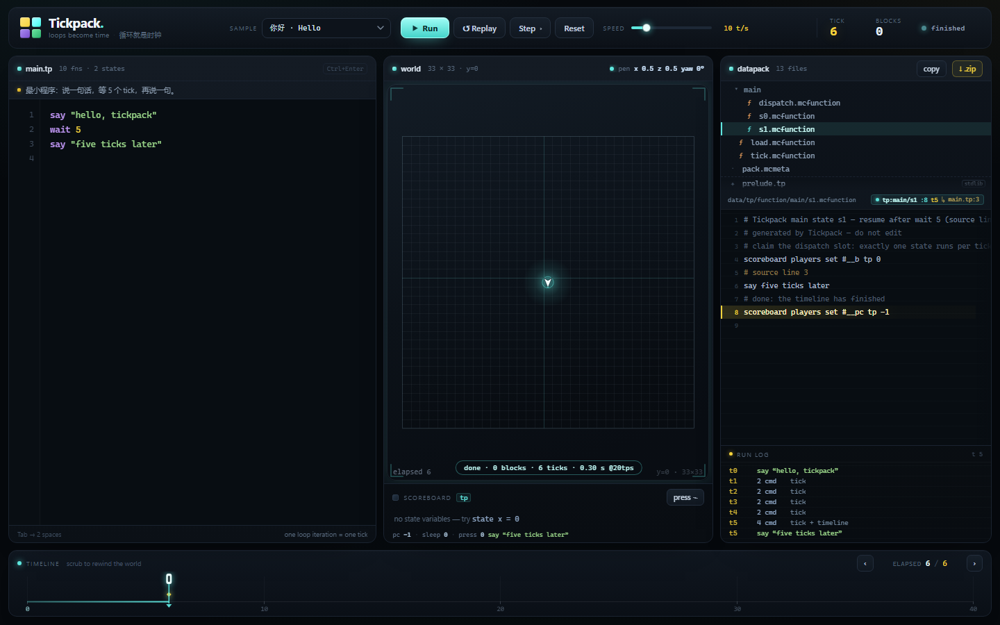

# Tickpack

**一门把 tick 当一等公民的语言。编译成真正的 Minecraft Java 版数据包，并配一个逐 tick 运行的浏览器模拟器。**

> 你写下 6 行循环，按下 Run，然后看见**循环变成了时间**：
> 每一个 tick 跑一次迭代，记分板里的 `i` 一格一格地加一，
> 生成的 mcfunction 一行一行地亮起来，世界里的笔一格一格地往前走。
> 拖时间轴往回走，世界会倒带。

这就是这个项目存在的理由。详细版见 [docs/WHY.md](docs/WHY.md)。


---

## 快速开始

```powershell
npm start                  # = node server.mjs，零依赖静态服务器
# 打开 http://127.0.0.1:8123/
```

打开就是一只会画画的笔，正方形示例已经自动跑起来了。浏览器里的四件事：

- **左边**：写代码。改一个数字，按 Run，世界重来。
- **中间**：逐 tick 看笔移动、方块出现、记分板变量跳动。
- **右边**：这份代码**真正生成出来的数据包**，正在执行的那一行会亮起来 —— 源码行和 mcfunction 行同步。
- **底部**：时间轴。每个 tick 都存了快照，点/拖动就把世界倒带到那一刻。
- 右上角 `↓ .zip` 下载整包，丢进 Minecraft 就能跑（见下）。

`hello` 示例演示最小程序：



## 语言长什么样

```
over 4 as side {
  over 8 as step {
    walk
    plot(stone)
  }
  turn(90)
}
```

- `over N as i { ... }` 是**时间循环**：每次迭代花 1 个 tick，`i` 存在记分板里。
  嵌套 `over` 就是一个 tick 计数器套另一个。
- `state x = 0` 是显式状态，编译成记分板 `#x`。
- `tick { ... }` 里的代码每个 tick 都跑；它不能花时间。
- `when press { ... }` 响应模拟器里的 press 按钮。
- 函数是编译期宏：`plot(gold_block)`、`turn(45)`、`walk` 来自内置的乌龟标准库。
- `run <命令>` 原样注入一条 vanilla 命令 —— 语言永远给你留了后门。

内置示例（切下拉框）：

| 示例 | 讲的是 |
| --- | --- |
| 正方形 | 嵌套时间循环：4 条边 × 8 步，每步 1 tick |
| 金色螺旋 | `state` 活在记分板上，`if` 控制边长增长 |
| 五角星 | 8 步 + 144°，5 笔画完，46 ticks |
| 圆 | 每 tick 转 8°，45 个 tick 走出半径 7 格的大圆 |
| 节拍器 | `tick {}` 每 tick 都跑 + `now % 20` + press |
| 你好 | 最小程序：`say` + `wait 5`，看 run log 里的时间 |

完整语法与编译模型：[docs/LANG.md](docs/LANG.md)。

## 它到底怎么工作

```
main.tp ──compile──▶ 真正的数据包文件（pack.mcmeta / mcfunction / tags）
                          │
                          ├──▶ 模拟器直接执行这些 mcfunction（不是另一套解释器）
                          │         │
                          │         └──▶ 每 tick 的 trace：文件 + 行号 + 命令
                          ▼
                    浏览器：编辑器 / 世界 / 数据包高亮 / 时间轴
```

- **编译产物是真的**：`data/tp/function/load.mcfunction` / `tick.mcfunction` 注册进
  `minecraft/tags/function/{load,tick}.json`，pack_format 48（Minecraft 1.21，单数目录名）。
- **模拟器不解释 AST**：它执行编译出来的 mcfunction 子集（记分板、execute、setblock、tp、summon……），
  所以你在浏览器里看到的行为就是数据包的行为。
- **控制流是状态机**：`over` / `wait` 编译成 `#__pc` + `#__sleep` 和一组 `main/sN.mcfunction`；
  每个 tick 只推进一个状态。记分板 `#i` 就是循环变量本身。
- **时间轴是快照**：每个 tick 存一份世界快照，可以随意回放、倒带。

## 把数据包放进 Minecraft

仓库里已经带了可直接安装的包：

- `dist/tickpack-square-datapack.zip`
- `dist/tickpack-star-datapack.zip`
- `dist/tickpack-spiral-datapack.zip`

自己生成任意示例的包：

```powershell
node scripts/pack.mjs star        # -> dist/tickpack-star-datapack.zip
```

安装：

1. 解压到 `saves/<世界>/datapacks/tickpack/`（`pack.mcmeta` 在那一层的根上）；
2. 进世界 `/reload`；
3. 那只 armor stand 笔出现在 `(0.5, 0, 0.5)`，然后每个 tick 画一格。

它没有用任何资源包/模组，纯原版数据包。

## 目录

| 路径 | 内容 |
| --- | --- |
| `docs/WHY.md` | 这个项目的「有趣的那一刻」和关键取舍记录 |
| `docs/LANG.md` | 语言 + 编译模型 + 模拟器契约 |
| `src/lang/` | 词法/语法/语义检查/状态机代码生成/数据包组装/标准库 |
| `src/sim/` | 微型 Minecraft 命令解释器：记分板、execute、实体、方块、trace |
| `web/` | 浏览器应用（无框架、无构建、无 CDN） |
| `src/api.js` | UI 唯一允许 import 的集成缝（compile / Simulator / SAMPLES / PRELUDE / packToZip） |
| `dist/` | 预生成的数据包 zip |
| `test/` | 编译器 50 + 模拟器 29 + 端到端 15 + zip 3 = **97 个测试** |
| `scripts/pack.mjs` | 生成可安装的数据包 zip |
| `scripts/dump.mjs` | 打印某个示例生成的数据包（调试编译器用） |
| `scripts/shot.ps1` | Edge headless 截图（QA 用） |

## 测试

```powershell
npm test                       # node test/run-all.mjs（不依赖子进程，任何环境都能跑）
node --test "test/*.test.js"   # 标准 Node test runner（需要允许 spawn）
node test/integration.test.js  # 只跑端到端
```

## 这一刀里有什么

- [x] 语言：`state` / `fn`（常量参数宏）/ `tick` / `when press` / `over` / `wait` / `if` / `else` /
      `say` / `run` / 表达式（算术、比较、`and`/`or`/`not`、`now`）
- [x] 编译成结构完整、可读的数据包（load/tick tags、主时间轴状态机、函数、宏展开、诊断信息）
- [x] 模拟器：记分板、execute 链、选择器、`~`/`^` 坐标、tp 旋转、setblock/fill、summon/kill/tag、
      say/particle、tick trace、快照回放
- [x] 浏览器：三栏同屏、逐 tick 运行、源码↔mcfunction 行锁步、记分板观察面板、
      run log、时间轴拖动回放、示例程序
- [x] 一键下载真正的数据包 `.zip`（零依赖 zip 写入器）
- [ ] 分享链接 / 只读分享页
- [ ] 积木视图（与文本共享 AST，时间线式布局）
- [ ] 更多事件源（按钮、`/trigger`、玩家动作）、数组、`after N ticks` 语法糖
- [ ] 红石 / schematic 输出

## 一些刻意的取舍

- 函数里不能 `wait` / `over` —— 函数是即时 mcfunction，只有**时间轴**上的代码才生成状态机。
  这条规则让「什么会花时间」在源码里是显式的。
- 调度用了一个 `#__b` latch：Minecraft 顺序执行函数里的每一行，而状态函数会改 `#__pc`，
  没有 latch 就会一个 tick 跑两个状态。见 LANG.md §2.3 的实现说明。
- 世界暂时是固定的一只笔（armor stand, `tag=pen`）在一块 33×33 的平面上，够用来画图案、
  也够把 tick 语义讲清楚。等语言更稳再换更通用的世界。
- 参数是编译期常量（`$param` 直接替换进 `run` 行）。没有运行时参数、没有闭包。
  以后也许会有，但不会以牺牲「循环就是时钟」为代价。
