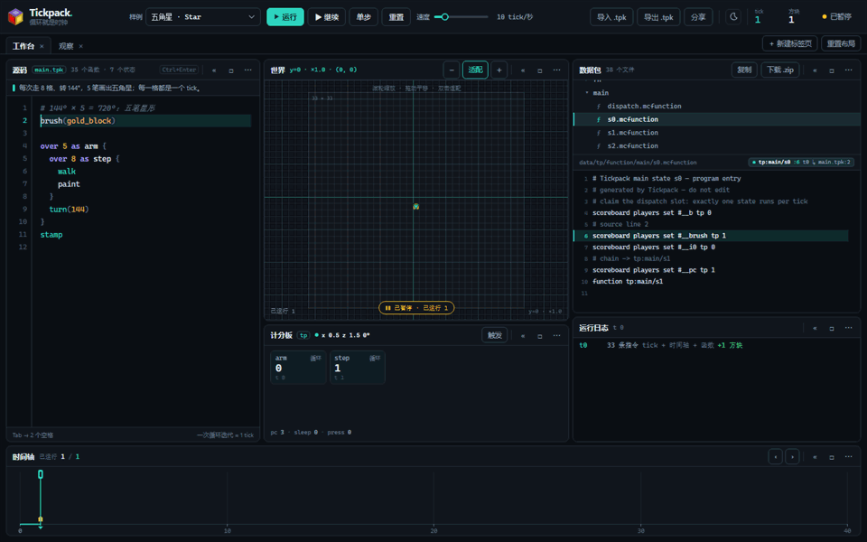
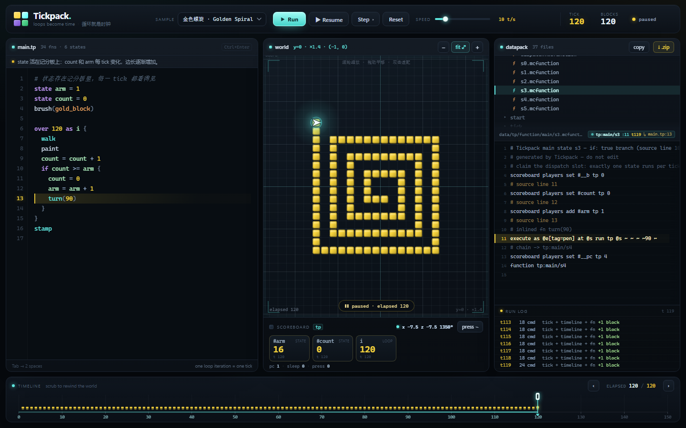
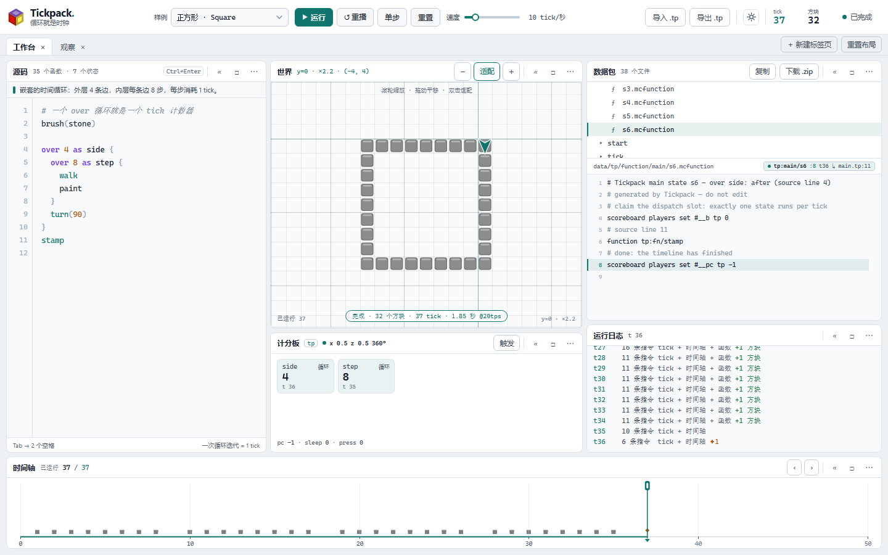
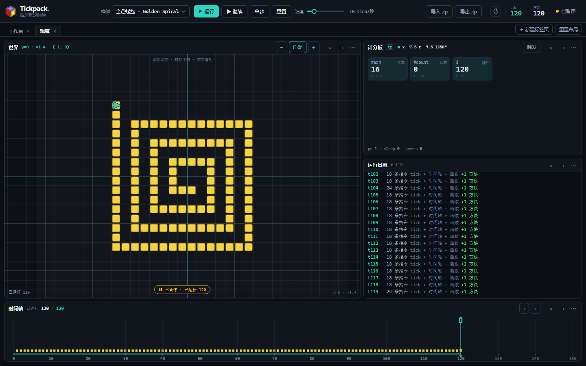
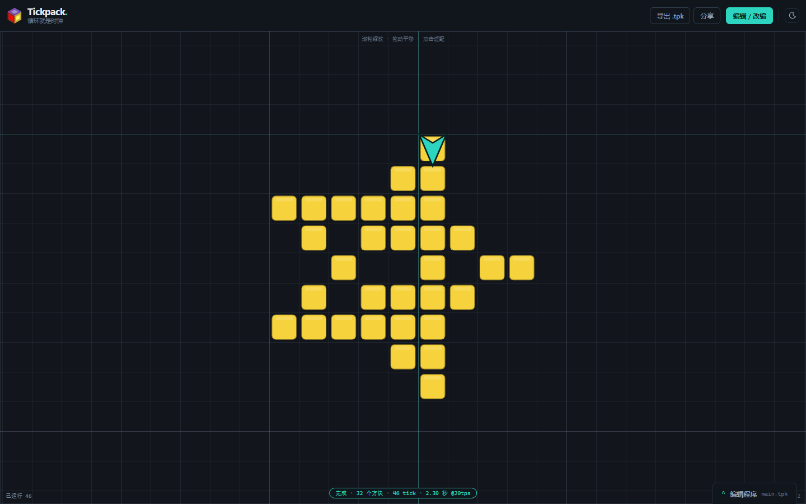
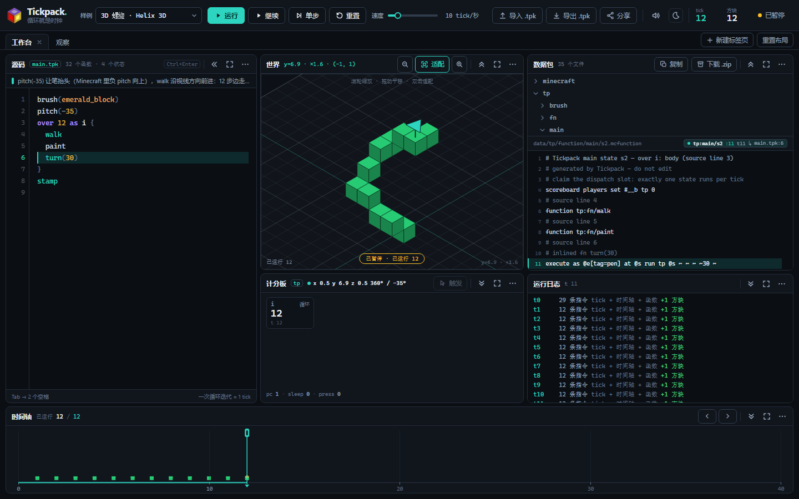

# Tickpack

**一门把 tick 当一等公民的语言。编译成真正的 Minecraft Java 版数据包，并配一个逐 tick 运行的浏览器模拟器。**

> 你写下 6 行循环，按下 Run，然后看见**循环变成了时间**：
> 每一个 tick 跑一次迭代，记分板里的 `i` 一格一格地加一，
> 生成的 mcfunction 一行一行地亮起来，世界里的笔一格一格地往前走。
> 拖时间轴往回走，世界会倒带。

这就是这个项目存在的理由。详细版见 [docs/WHY.md](docs/WHY.md)。

**▶ [在线试玩](https://xxzh-code.github.io/Tickpack/) · [Releases](https://github.com/xxzh-code/Tickpack/releases) · [单文件 HTML](dist/tickpack.html) · [GitHub](https://github.com/xxzh-code/Tickpack)**





---

## 快速开始

```powershell
npm start                  # = node server.mjs，零依赖静态服务器
# 打开 http://127.0.0.1:8123/
```

```powershell
npm link                   # 之后可用 CLI：tickpack / tpk
tickpack serve --port 8123
tickpack build my-program.tpk   # 编译成可安装的数据包 zip
tickpack pack star              # 编译内置示例
```

打开就是一只会画画的笔，正方形示例已经自动跑起来了。界面全中文，默认跟随系统深浅色：

- **源码**：写代码。改一个数字，按「运行」，世界重来。
- **世界**：逐 tick 看笔移动、方块出现、计分板变量跳动；自动适配全部内容，滚轮缩放 / 拖动平移 / 双击适配。
- **数据包**：这份代码**真正生成出来的数据包**，正在执行的那一行会亮起来 —— 源码行和 mcfunction 行同步。
- **时间轴**：每个 tick 都存了快照，点/拖动就把世界倒带到那一刻。
- **标签页 + 分栏**：源码/世界/数据包/计分板/运行日志/时间轴都是独立面板；可以拖动标题栏调整布局、折叠、最大化、用面板菜单移动或复制到其他标签页；标签页可拖动排序、右键添加缺失分栏/仅重置当前页。布局自动记住。默认两个工作页：「工作台」和「观察」。
- **导入 / 导出 `.tpk`**：把程序存成单个 `.tpk` 文本文件，或从文件载入；右上角 `下载 .zip` 则是可直接进 Minecraft 的整包。

`hello` 示例演示最小程序：


## 界面

- 日间 / 夜间模式：顶栏 ☀/☾ 切换，记住选择；没选过时跟随系统。
- 扁平化：没有无意义的渐变/发光/装饰动画；保留的都是有信息量的提示——当前执行行、源码行高亮、诊断标记、时间轴播放头、方块出现的短促反馈。
- 分栏操作：拖动分隔条调整大小，拖动面板标题栏调整组树布局；面板标题栏「折叠 / 最大化 / ⋯ → 移动或复制到标签页」；标签页可新建、拖动排序、双击重命名、右键菜单（添加缺失分栏/仅重置当前页/关闭）；「重置布局」恢复默认。
- 品牌 logo 来自 `logo/`（顶栏 `logo-small.svg`，favicon `logo-minimal.svg`）。

日间模式：



「观察」标签页（世界 / 计分板 / 运行日志 / 时间轴）：



分享链接默认进入轻剧场模式（源码折叠为底部抽屉）：



## 语言长什么样

```
brush(stone)
over 4 as side {
  over 8 as step {
    walk
    paint
  }
  turn(90)
}
```

- `over N as i { ... }` 是**时间循环**：每次迭代花 1 个 tick，`i` 存在记分板里。
  嵌套 `over` 就是一个 tick 计数器套另一个。
- `state x = 0` 是显式状态，编译成记分板 `#x`。
- `brush(block)` 设置**运行时画笔**（编译成记分板 `#__brush` 的调色板下标）；
  `paint` 用当前画笔画一块。所以游戏里 `/function tp:brush/redstone_block` 能即时换色。
  `plot(block)` 是更直接的写法：把某种方块写死在程序里。
- `tick { ... }` 里的代码每个 tick 都跑；它不能花时间。
- `when press { ... }` 响应模拟器里的 press 按钮。
- `ahead(stone)` / `below(stone)` 读取笔前方/下方的方块，让程序能根据世界做决定。
- 函数是编译期宏：`plot(gold_block)`、`turn(45)`、`walk` 来自内置的乌龟标准库。
- `run <命令>` 原样注入一条 vanilla 命令 —— 语言永远给你留了后门。

内置示例（切下拉框）：

| 示例 | 讲的是 |
| --- | --- |
| 正方形 | 嵌套时间循环：4 条边 × 8 步，每步 1 tick |
| 金色螺旋 | `state` 活在记分板上，`if` 控制边长增长 |
| 五角星 | 8 步 + 144°，5 笔画完，46 ticks |
| 圆 | 每 tick 转 8°，45 个 tick 走出半径 7 格的大圆 |
| 彩虹圆 | `brush` 每三步换色：运行时画笔 |
| 无尽螺旋 | `tick {}` + `state`：不结束的方形螺旋；游戏里随时换笔 / `tp:stop` 暂停 |
| 魔法螺旋 | 每 tick 留一颗粒子；方形螺旋越走越大，浏览器和 Minecraft 同步冒光 |
| 3D 螺旋 | `pitch(-35)` 抬头，`walk` 沿视线向上，12 步画出正交 3D 螺旋 |
| 沿墙 | `ahead(stone)` 看正前方，碰到墙就转，否则前进并画金线 |
| 挥手 | `animate(@p, "wave", 20 ticks)` 一行意图，展开为粒子波浪 |
| 手势串 | wave → nod → spin 三个命名意图；新的 animate 覆盖旧动画 |
| 节拍器 | `tick {}` + `now % 20` + press；每 20 tick 响一声、闪一次 |
| 你好 | 最小程序：`say` + `wait 5`，看 run log 里的时间 |


3D 螺旋示例（正交投影，浏览器与 Minecraft 同一份数据包）：



完整语法与编译模型：[docs/LANG.md](docs/LANG.md)。

## 它到底怎么工作

```
main.tpk ──compile──▶ 真正的数据包文件（pack.mcmeta / mcfunction / tags）
                          │
                          ├──▶ 模拟器直接执行这些 mcfunction（不是另一套解释器）
                          │         │
                          │         └──▶ 每 tick 的 trace：文件 + 行号 + 命令
                          ▼
                    浏览器：编辑器 / 世界 / 数据包高亮 / 时间轴
```

- **编译产物是真的**：`data/tp/function/load.mcfunction` / `tick.mcfunction` 注册进
  `minecraft/tags/function/{load,tick}.json`，pack_format 48（Minecraft 1.21，单数目录名）。
- **模拟器不解释 AST**：它执行编译出来的 mcfunction 子集（记分板、execute、setblock、tp、summon……），
  所以你在浏览器里看到的行为就是数据包的行为。
- **控制流是状态机**：`over` / `wait` 编译成 `#__pc` + `#__sleep` 和一组 `main/sN.mcfunction`；
  每个 tick 只推进一个状态。记分板 `#i` 就是循环变量本身。
- **时间轴是快照**：每个 tick 存一份世界快照，可以随意回放、倒带。
- **真实世界里它等你**：数据包不会在世界加载时偷偷跑完；它等到有玩家，然后把画笔
  锚定到**你脚下的地面**（`execute positioned` 可以指定坐标），聊天栏报一句，
  再开始逐 tick 画。`/function tp:start` 回到脚下、`tp:start_at` 指定坐标、
  `tp:brush/*` 换画笔、`tp:status` 自检。
  浏览器里则有一个虚拟玩家站在同一位置，所以两边画出同样的坐标。
- **world 视口会自己适配**：默认 2D 示例仍是原来的俯视平面；3D 内容自动切到正交等轴视图
  （`x,y,z` 立方体、深度排序、pen pitch）。自动把整幅画装进画面（大于 33×33 也行），
  滚轮缩放、拖动平移、双击/`F`/`fit` 重新适配；暂停/完成后一定框住全部内容。

## 把数据包放进 Minecraft

仓库里已经带了可直接安装的包（每个示例一个）：

```
dist/tickpack-square-datapack.zip    dist/tickpack-remix-datapack.zip
dist/tickpack-star-datapack.zip      dist/tickpack-spiral-datapack.zip
dist/tickpack-circle-datapack.zip    dist/tickpack-rainbow-datapack.zip
dist/tickpack-metronome-datapack.zip dist/tickpack-hello-datapack.zip
dist/tickpack-endless-datapack.zip   dist/tickpack-magic-datapack.zip
dist/tickpack-helix3d-datapack.zip   dist/tickpack-senses-datapack.zip
dist/tickpack-wave-datapack.zip      dist/tickpack-gestures-datapack.zip
dist/tickpack.html（单文件版）
```

自己生成任意示例的包：

```powershell
node scripts/pack.mjs star        # -> dist/tickpack-star-datapack.zip
```

### 安装（1.21+，原版或 Fabric/Forge 都行）

1. **放进世界的数据包目录，不是资源包目录**：
   `saves/<世界名>/datapacks/tickpack-star-datapack.zip`
   （zip 可以直接放，不用解压；也可以解压成文件夹，只要 `pack.mcmeta` 在文件夹根上。）
2. 进世界（如果已经在游戏里，用 `/datapack list` 确认能看到
   `file/tickpack-star-datapack.zip` 是 enabled，或者 `/reload` 一次）。
3. **等 1 个 tick**：数据包会等到有玩家，然后自动把画笔放到**你脚下的地面**上，
   聊天栏出现 `Tickpack: 开始绘制…`，方块开始一个 tick 画一格。
4. 想换个地方重画：`/function tp:start`（会在你当前脚下重新开始；旧图案会留在原地）。

> 数据包是「等你来」的：世界加载时它不会动，直到有玩家在**主世界**里才启动——
> 这样你一进游戏就能看见它画，而不是加载时偷偷画完。

### 游戏内指令（都支持 Tab 补全）

| 指令 | 作用 |
| --- | --- |
| `/function tp:start` | 把画笔放回你脚下，从头重画 |
| `/execute positioned <x> <y> <z> run function tp:start_at` | 在指定方块坐标重画；`y` 就是作画那一层 |
| `/function tp:brush/<block>` | 换画笔方块，立刻生效（12 种：`stone` `gold_block` `redstone_block` `emerald_block` `lapis_block` `diamond_block` `coal_block` `glowstone` `white_wool` `purple_wool` `oak_planks` `glass`） |
| `/function tp:brush/next` | 切到下一支画笔 |
| `/function tp:stop` | 暂停在原地（画笔和已经画好的方块保留；`tp:start` 可继续/重画） |
| `/function tp:status` | 自检：在等玩家 / 在运行 / 已暂停 / 画笔在哪 / 当前画笔是什么方块 |

画笔是**运行时**的：程序里的 `brush(...)` 会覆盖它，`paint` 每次画当前画笔。
`无尽涂鸦` / `彩虹圆` 示例就是用来在游戏里按 `tp:brush/...` 换色玩的。

### 看不到效果？按这个顺序查

1. **你把它放到 `resourcepacks/` 了吗？** 这是最容易犯的错（资源包不会执行函数）。
   正确位置是 `<存档>/datapacks/`，不是 `.minecraft/resourcepacks/`。
2. `/datapack list` 里有没有它？没有就检查存档路径/zip 结构（`pack.mcmeta` 必须在 zip 根上）。
3. 有但显示 disabled：`/datapack enable "file/tickpack-star-datapack.zip"`。
4. 有没有聊天栏消息？没有说明 `tp:tick` 没跑起来（通常是没对上版本或没真正启用）。
5. 手动 `/function tp:start`；再不行 `/function tp:load` 然后 `/function tp:start`。
6. `/function tp:status` 会告诉你数据包现在怎么想：在等玩家 / 在运行 / 画笔在不在。
7. 确保你在**主世界**，并且脚下方块正常（画笔画在脚下那一层，会替换地面方块）。

它没有用任何资源包/模组，纯原版数据包；`pack.mcmeta` 带 `supported_formats`（48..9999），
1.21.x 都能加载。

## 命名与标识

- 正式名 **Tickpack**；CLI `tickpack`（短别名 `tpk`）；程序文件扩展名 **`.tpk`**（导入兼容旧 `.tp`）。
- 环境变量前缀 `TICKPACK_`；数据包默认命名空间 `tp`；多包命名空间规则见 [docs/NAMING.md](docs/NAMING.md)。
- 分享链接统一带 `v=1`；版本不匹配时会提示行为可能不同。

## 目录

| 路径 | 内容 |
| --- | --- |
| `docs/WHY.md` | 这个项目的「有趣的那一刻」和关键取舍记录 |
| `docs/LANG.md` | 语言 + 编译模型 + 模拟器契约 |
| `docs/ARCH.md` | **核心/外壳分层**、Host 窄接口、边界守卫（换 Electron/Tauri 时看这个） |
| `src/lang/` | 核心：词法/语法/语义检查/状态机代码生成/数据包组装/标准库 |
| `src/sim/` | 核心：微型 Minecraft 命令解释器：记分板、execute、实体、方块、trace |
| `src/session.js` | 核心：一次运行的语义（编译→模拟→快照→seek→完成判定→trace→源码行→导出包），无 DOM |
| `src/api.js` | 核心唯一门面（compile / Simulator / TickpackSession / SAMPLES / PRELUDE / packToZip） |
| `web/` | 外壳：浏览器应用（无框架、无构建、无 CDN） |
| `web/host-web.js` | 外壳：平台副作用唯一实现（下载 zip、写剪贴板）；桌面端换实现即可 |
| `bin/tickpack.mjs` | CLI 外壳：`tickpack` / `tpk`（serve / build / pack / list） |
| `.github/workflows/pages.yml` | GitHub Pages 部署 + 每次 push 跑全量测试 |
| `docs/NAMING.md` | 命名与标识、`.tpk`、CLI、数据包命名空间规则（设计） |
| `scripts/build-html.mjs` | 零依赖单文件 HTML 构建 |
| `dist/` | 预生成的数据包 zip + 单文件 HTML |
| `test/` | 编译器/模拟器/端到端/会话/zip/分层守卫/构建 + 布局 13 + layout-drag 18 + world3d 9 + UI 10 = **231 个测试**（以 `node test/run-all.mjs` 为准） |
| `scripts/pack.mjs` | 生成可安装的数据包 zip（Node 外壳的导出实现） |
| `scripts/dump.mjs` | 打印某个示例生成的数据包（调试编译器用） |
| `scripts/shot.ps1` | Edge headless 截图（QA 用） |

## 测试

```powershell
npm test                       # node test/run-all.mjs（不依赖子进程，任何环境都能跑）
node --test "test/*.test.js"   # 标准 Node test runner（需要允许 spawn）
node test/integration.test.js  # 只跑端到端
```

分层守卫 `test/purity.test.js` 会扫描 `src/**`：出现 `window`/`document`/`fs`/`process`/
`isElectron` 这类平台 API 或环境分支就让测试失败——避免外壳的便利渗进核心。
详细分层与 Host 接口见 [docs/ARCH.md](docs/ARCH.md)。

## 这一刀里有什么

- [x] 语言：`state` / `fn`（常量参数宏）/ `tick` / `when press` / `over` / `wait` / `if` / `else` /
      `say` / `run` / 表达式（算术、比较、`and`/`or`/`not`、`now`）
- [x] 编译成结构完整、可读的数据包（load/tick tags、主时间轴状态机、函数、宏展开、诊断信息）
- [x] 模拟器：记分板、execute 链、选择器、`~`/`^` 坐标、tp 旋转、setblock/fill、summon/kill/tag、
      say/particle、tick trace、快照回放
- [x] 浏览器：三栏同屏、逐 tick 运行、源码↔mcfunction 行锁步、记分板观察面板、
      run log、时间轴拖动回放、示例程序
- [x] 一键下载真正的数据包 `.zip`（零依赖 zip 写入器）
- [x] 真实 Minecraft 行为：等玩家进世界 → 画笔锚在脚边 → 开始画；`/function tp:start`
      重画、`tp:start_at` 指定坐标（`/execute positioned`）、`tp:brush/*` 游戏内换画笔、
      `tp:status` 自检；pack.mcmeta 兼容 1.21.x（supported_formats）
- [x] world 视口：自动适配全部内容（画布不再被 33×33 截断）、滚轮缩放、拖动平移、双击/F 适配
- [x] 界面：全中文、日间/夜间模式、扁平化；标签页 + 可调整/折叠/最大化/移动/复制的分栏面板；组树 header 拖动、整组折叠胶囊、标签页排序/右键菜单/单页重置，布局持久化；
- [x] 3D：`x,y,z` + `up/down/pitch`，正交投影立方体、深度排序、3D 自动适配/缩放/平移；默认 2D 不回归，`helix3d` 浏览器与 Minecraft 同步；
      `logo/` 品牌；导入/导出 `.tpk`
- [x] 分层：核心（编译器/模拟器/会话/zip）零平台依赖 + 外壳（DOM/下载/剪贴板/文件/持久化）通过
      `TickpackSession` / `web/host-web.js` 窄接口连接；`test/purity.test.js` 守卫边界
- [x] P0 传播基建：GitHub Pages 在线试玩、分享链接（`v=1` + 剧场模式）、单文件 HTML、README 动图
- [x] 命名统一：文件扩展名 `.tpk`；CLI `tickpack` / `tpk`；环境变量 `TICKPACK_*`；数据包默认命名空间 `tp`（多包规则见 docs/NAMING.md）
- [ ] 多包命名空间实现（`pack "name"` → `tp_<name>`，P0 只定设计）
- [ ] 积木视图（与文本共享 AST，时间线式布局）
- [ ] 更多事件源（按钮、`/trigger`、玩家动作）、数组、`after N ticks` 语法糖
- [ ] 红石 / schematic 输出

## 一些刻意的取舍

- 函数里不能 `wait` / `over` —— 函数是即时 mcfunction，只有**时间轴**上的代码才生成状态机。
  这条规则让「什么会花时间」在源码里是显式的。
- 调度用了一个 `#__b` latch：Minecraft 顺序执行函数里的每一行，而状态函数会改 `#__pc`，
  没有 latch 就会一个 tick 跑两个状态。见 LANG.md §2.3 的实现说明。
- 世界暂时是一只手绘的笔（armor stand, `tag=pen`）：默认画在**玩家脚下的那一层**，
  也可以 `/execute positioned` 指定坐标。浏览器里那块“地面”就是 y=0 的平面；
  画大了会自动缩放视野，不再被 33×33 截断。等语言更稳再换更通用的世界。
- 参数是编译期常量（`$param` 直接替换进 `run` 行）。没有运行时参数、没有闭包。
  以后也许会有，但不会以牺牲「循环就是时钟」为代价。

## Vibe coding 程度

本项目是 **vibe coding 驱动**的项目：大量界面、测试、文档和迭代由 AI 编程代理完成；需求边界、架构取舍、关键 bug 定位和发布验收由人工主导与确认。它不是“一键生成、不做审查”的项目——每个发布版本都经过自动测试和真实浏览器/CDP 验收。

## 许可证

MIT —— 随便玩、改、卖、再发布，保留版权声明即可。见 [LICENSE](LICENSE)。
